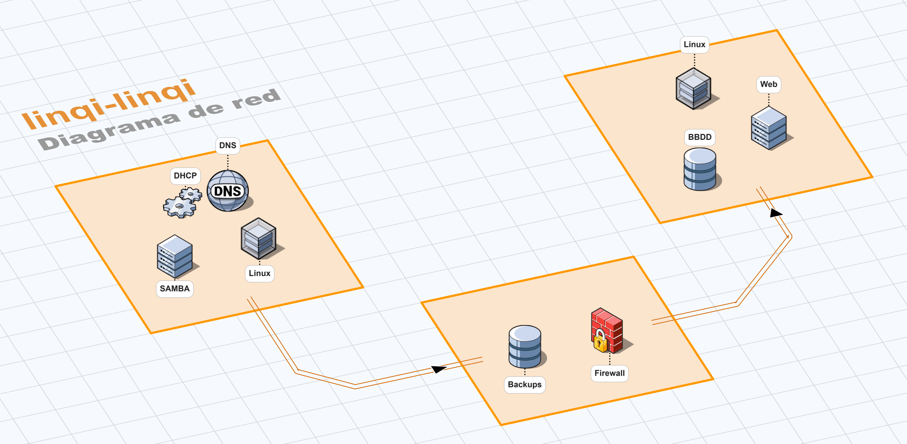
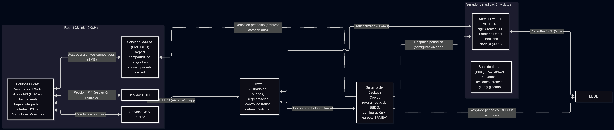

---
layout:
  width: wide
  title:
    visible: true
  description:
    visible: true
  tableOfContents:
    visible: true
  outline:
    visible: true
  pagination:
    visible: true
  metadata:
    visible: true
  tags:
    visible: true
  actions:
    visible: true
  anchors:
    visible: true
---

# Arquitectura de red

### <mark style="color:$primary;">Funcionalidades</mark>

<table><thead><tr><th width="64">ID</th><th width="86">Prioridad</th><th width="198">Objetivo</th><th width="349">Funcionalidad</th><th>Fecha Entrega</th><th>Estado</th></tr></thead><tbody><tr><td>ID1</td><td><mark style="color:$danger;">Alta</mark></td><td>Subir y validar archivos de audio para iniciar una sesión de masterización.</td><td>Permitir cargar archivos de audio locales (WAV, FLAC, MP3, OGG) mediante selección de archivo o <em>drag-and-drop</em>, validando formato, tamaño máximo y frecuencia de muestreo, y decodificando la señal en el navegador (Web Audio API).</td><td></td><td></td></tr><tr><td>ID2</td><td><mark style="color:$danger;">Alta</mark></td><td>Reproducir el audio y controlar la escucha durante la sesión.</td><td>Implementar un reproductor con controles de <em>play/pause</em>, <em>stop</em>, <em>seek</em> (posición en línea de tiempo), bucle (<em>loop</em>) de región y control de volumen general con <em>bypass</em> global para comparar original vs. procesado.</td><td></td><td></td></tr><tr><td>ID3</td><td><mark style="color:$danger;">Alta</mark></td><td>Visualizar la forma de onda y niveles clave para tomar decisiones de masterización.</td><td>Renderizar la forma de onda del audio en tiempo real y mostrar medidores de nivel (pico, <em>RMS</em> y estimación de <em>LUFS</em>) junto con un analizador espectral básico para detectar saturación o desequilibrios tonales.</td><td></td><td></td></tr><tr><td>ID4</td><td><mark style="color:$danger;">Alta</mark></td><td>Aplicar y reordenar efectos de masterización en cadena con escucha en tiempo real.</td><td>Crear una cadena de procesamiento modular (<em>audio graph</em> dinámico) que permita añadir, activar/desactivar (<em>bypass</em>), reordenar y eliminar efectos (EQ paramétrico, compresor, saturador, limitador) escuchando los cambios al instante sin cortes perceptibles.</td><td></td><td></td></tr><tr><td>ID5</td><td><mark style="color:$danger;">Alta</mark></td><td>Exportar y descargar el audio masterizado final con buena calidad.</td><td>Renderizar la mezcla procesada (mediante <code>OfflineAudioContext</code> o procesamiento equivalente) evitando <em>clipping</em> digital y permitir descargar el archivo resultante en formatos WAV (16/24-bit PCM) y MP3/FLAC según configuración.</td><td></td><td></td></tr><tr><td>ID6</td><td><mark style="color:$warning;">Media</mark></td><td>Ajustar con precisión los parámetros de cada efecto de la cadena.</td><td>Diseñar controles específicos para cada módulo (frecuencia, ganancia, Q, <em>threshold</em>, <em>ratio</em>, <em>attack</em>, <em>release</em>, <em>drive</em>, <em>ceiling</em>) con entradas numéricas/sliders, restablecimiento por defecto y preajustes (<em>presets</em>) iniciales por estilo o objetivo.</td><td></td><td></td></tr><tr><td>ID7</td><td><mark style="color:$warning;">Media</mark></td><td>Guiar al usuario paso a paso durante el proceso de masterización.</td><td>Implementar un asistente/guía de sesión con etapas ordenadas (ej. preparación y ganancia, limpieza/EQ, dinámica, color/amplitud, limitación y exportación) que indique qué revisar en cada fase y permita avanzar o retroceder libremente.</td><td></td><td></td></tr><tr><td>ID8</td><td><mark style="color:$warning;">Media</mark></td><td>Apoyar cada paso con recursos visuales, consejos y trucos prácticos.</td><td>Integrar en la guía ilustraciones/diagramas explicativos, <em>tips</em> contextuales según el paso actual y trucos prácticos (ej. <em>gain staging</em>, evitar sobrecompresión, escuchar a bajo volumen) vinculados a los efectos activos.</td><td></td><td></td></tr><tr><td>ID9</td><td><mark style="color:$success;">Baja</mark></td><td>Consultar definiciones técnicas de masterización sin salir de la sesión.</td><td>Incorporar un glosario interactivo con buscador y enlaces contextuales desde los parámetros y la guía (términos como <em>LUFS</em>, <em>headroom</em>, <em>dynamic rang</em>e, <em>clipping</em>, <em>dithering</em>, <em>transient</em>).</td><td></td><td></td></tr><tr><td>ID10</td><td><mark style="color:$success;">Baja</mark></td><td>Guardar o recuperar el progreso de una sesión de trabajo.</td><td>Permitir guardar el estado de la cadena de efectos, parámetros y paso actual de la guía en almacenamiento local (<code>localStorage</code>/JSON) o cuenta de usuario para retomar una sesión posterior.</td><td></td><td></td></tr></tbody></table>

### Arquitectura del sistema

> _Uno de los fundamentos de arquitectura es la identificación de componentes: esto se refiere a determinar las piezas clave o módulos que compondrán una aplicación web. Cada componente realiza funciones específicas y se integra con otros para lograr el conjunto completo de características y servicios requeridos por la aplicación._


La arquitectura obligatoriamente será cliente-servidor, pero debes tener en cuenta los requerimientos técnicos para realizar el trabajo. Identifica el software, la versión a utilizar, el puerto de funcionamiento y el dominio si así lo requiera y explica brevemente para que se va a utilizar esa tecnología.


<table><thead><tr><th width="116">Componente de sistema</th><th width="139">Tecnología o framework</th><th width="125">Versión</th><th width="153">Puerto</th><th width="247">Descripción de uso o requisitos</th><th>Enlace a documentación o información adicional</th></tr></thead><tbody><tr><td><strong>Hardware</strong></td><td>Servidor (2 vCPU, 4 GB RAM, 40 GB) + Equipo cliente con tarjeta de sonido</td><td>x86_64 / ARM64 (mín. 4 GB RAM en cliente)</td><td>N/A</td><td>Alojamiento de la aplicación y base de datos en el servidor. El equipo cliente ejecuta el procesamiento DSP en tiempo real y requiere salida de audio (tarjeta de sonido integrada o interfaz externa) y auriculares o monitores.</td><td></td></tr><tr><td><strong>Sistema operativo</strong></td><td>Ubuntu Server LTS (Servidor) / Multiplataforma (Cliente)</td><td>24.04 LTS</td><td>N/A</td><td>Sistema operativo del servidor encargado de alojar el servidor web, el backend y la base de datos. En el cliente es compatible con Windows, macOS y Linux mediante navegador moderno.</td><td></td></tr><tr><td><strong>Interfaz de usuario (</strong><em><strong>Frontend</strong></em><strong>)</strong></td><td></td><td></td><td>5173 (desarrollo) / 443 (producción)</td><td>Interfaz web interactiva con visualización de forma de onda, cadena modular de efectos en tiempo real, medidores de nivel y vista paso a paso de la guía, consejos y glosario.</td><td></td></tr><tr><td><strong>Servidor web</strong></td><td>Nginx</td><td>1.26 LTS</td><td>80 (HTTP) / 443 (HTTPS)</td><td>Servidor web y proxy inverso que sirve los archivos estáticos del frontend (SPA), gestiona certificados SSL/TLS y redirige las peticiones <code>/api</code> hacia el backend.</td><td></td></tr><tr><td><strong>Base de datos</strong></td><td>Esquema relacional de la aplicación</td><td></td><td>5432</td><td>Almacena cuentas de usuario, configuraciones guardadas de cadenas de efectos (<em>presets</em>), historial de sesiones y los contenidos estructurados de la guía (pasos, imágenes, consejos y términos del glosario).</td><td></td></tr><tr><td><strong>Sistema gestor de base de datos</strong></td><td>PostgreSQL</td><td>17</td><td>5432</td><td>Motor SGBD relacional encargado de gestionar, persistir y consultar de forma segura e íntegra los datos de usuarios, proyectos y recursos didácticos.</td><td></td></tr><tr><td><strong>Servicios de APIs</strong></td><td>Web Audio API (Nativa del navegador) + API REST en Node.js (Express)</td><td>Web Audio API (W3C) / Node.js 22 LTS</td><td>N/A (Cliente) / 3000 (API REST)</td><td>Web Audio API procesa y encadena los efectos de audio (EQ, compresor, limitador) en tiempo real y exporta el archivo final en el navegador. API REST (Node/Express) gestiona autenticación, guardado de sesiones y consulta del glosario/guía.</td><td></td></tr></tbody></table>

### Diagrama de red

<figure><figcaption></figcaption></figure>

<figure><figcaption></figcaption></figure>

| **Componente**     | **Rol en la arquitectura**                                                                                                               | **Flujo principal / Puerto habitual**                                       |
| ------------------ | ---------------------------------------------------------------------------------------------------------------------------------------- | --------------------------------------------------------------------------- |
| DHCP               | Asigna automáticamente direcciones IP, puerta de enlace y servidores DNS a los equipos cliente de la red local.                          | UDP 67 / 68 (red local)                                                     |
| DNS                | Traduce nombres de dominio o nombres de host internos a direcciones IP para acceder a servicios sin memorizar IPs.                       | UDP/TCP 53                                                                  |
| SAMBA              | Comparte carpetas en red mediante SMB/CIFS para intercambiar archivos de audio, proyectos o recursos de trabajo en la red local.         | TCP 445 (y NetBIOS 137–139 si aplica)                                       |
| Firewall           | Controla el tráfico entre redes, bloquea puertos no autorizados, aplica reglas de acceso y protege servidores y clientes.                | Filtrado perimetral / reglas de red                                         |
| Web                | Sirve la interfaz web de masterización (Frontend) y atiende la API REST para sesiones, presets, guía y glosario.                         | TCP 80 (HTTP) / TCP 443 (HTTPS)                                             |
| Base de datos      | Almacena de forma persistente usuarios, sesiones de masterización, configuraciones y contenidos de la guía/glosario (PostgreSQL).        | TCP 5432 (acceso restringido desde servidor app/backup)                     |
| Sistema de backups | Realiza copias de seguridad periódicas (locales o remotas) de la base de datos, recursos SAMBA y configuraciones ante fallos o borrados. | Acceso programado / cifrado (ej. SSH/SFTP, rsync o almacenamiento dedicado) |

####
